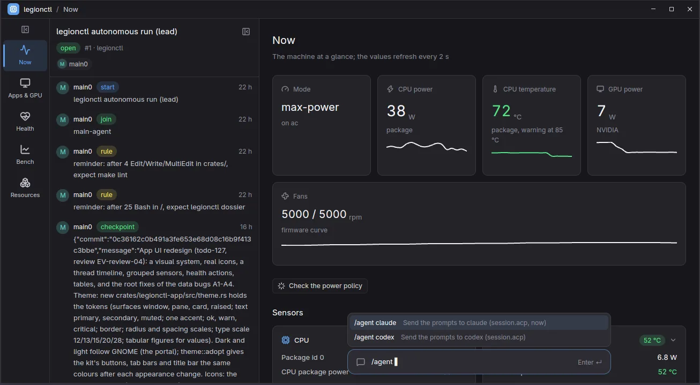
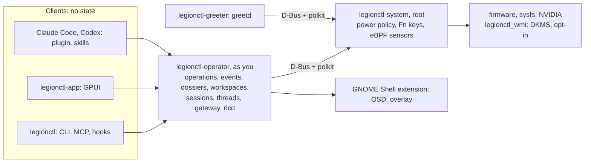

# legionctl

One operator for this laptop and the coding agents on it. legionctl keeps the Legion Pro 7 in the power state you
want, shows you why it is hot or slow, and runs Claude Code and Codex in sandboxes that remember their work and cannot
change the machine without you.



| | |
| --- | --- |
| Machine | `LENOVO 82WQ`, Legion Pro 7 16IRX8H, BIOS `KWCN54WW` (1.54), EC 1.51. One model only: legionctl does not guess safe values for other models. |
| Use it | [docs/guide](docs/guide/README.md): install, the app, agents, safety |
| Design | [docs/design](docs/design/README.md): each design note and its real state |
| API | [docs/api/schema.json](docs/api/schema.json): every operation with its class and input schema |

## Why it is different

- **One operator, one API.** Each capability is one operation: 199 public operations (86 read, 25
  session, 45 workspace, 43 machine). The desktop app (the only UI), the CLI, the MCP server and the agent hooks are
  adapters to the same operation, with the same permission and the same event log.
- **Safety by design.** An agent can read everything. It cannot change the machine: each machine change goes to a
  root daemon through a polkit dialog that only you can approve. Many changes have `--dry-run`, and `undo <event>`
  turns a change back. A failed call fails with its reason; there are no silent fallbacks.
- **Agents that remember.** Each agent session binds a dossier (`~/agentWorkspaces/<name>`): a plan, numbered
  memory, designs and evidence. Code changes go into a git worktree per dossier or per topic. A code graph and a
  planned graph show what changed and what is still to build (`legionctl code plan status`).
- **Agents that watch each other.** A thread has a main agent and observers. Observers review tests, remind the main
  agent of skipped steps, and can block it until it answers. Messages go through a durable outbox.
- **Generative UI.** Each screen of the app is a view: a declarative spec over read operations. Text in the chat bar
  (or `legionctl ask "<intent>"`) opens the stored view of that intent at no model cost; else rlcd picks a stored
  view of a similar intent; else the ui-composer (Haiku on Claude Code, bound to the view tools only) makes one from
  the parts library and saves it. `legionctl views cost` shows what each step cost.

## The parts



| Part | Runs as | Does |
| --- | --- | --- |
| `legionctl` | you | CLI, `legionctl mcp`, `legionctl hook <event>` for Claude Code |
| `legionctl-app` | you | the desktop app: pages Now, Apps & GPU, Health, Bench, Resources; the thread log; a chat bar to an agent |
| `legionctl-operator` | you, `legionctl-operator.socket` (user) | the API on `$XDG_RUNTIME_DIR/legionctl/api.sock`: reads, plans, agent tooling, the event log |
| `legionctl-system` | root, `legionctl-system.service` | power policy at start, charger change, Fn+Q and resume; D-Bus `org.legionctl.System1`; eBPF sensors |
| `legionctl-safe.service` | root | starts when the daemon fails: `balanced` mode and a desktop warning |
| `legionctl-boot-confirm.service` | root, each start after `graphical.target` | a start through legionctl's boot entry makes it the default, and a desktop notice says so |
| `legionctl-greeter` | greetd | the login screen in place of GDM (opt-in: `legionctl greeter install`) |
| `legionctl-osd@legionctl` | GNOME Shell | the OSD for Fn+Q, Fn+R and Fn lock; the vitals overlay (`legionctl overlay`) |
| `legionctl_wmi` | kernel, DKMS | our driver for the Legion WMI. The package blacklists it (`/usr/lib/modprobe.d/legionctl-wmi.conf`), so the in-tree `lenovo_wmi_*` drivers stay the default. See [08-kernel](docs/design/08-kernel.md). |

State is in `/var/lib/legionctl/system.db` (machine), `~/.local/state/legionctl/operator.db` (events, threads)
and `~/agentWorkspaces/<dossier>/` (each with `.state/dossier.db`). Configuration is JSONC files only:
`config/defaults.jsonc`, then `/etc/legionctl`, `~/.config/legionctl`, `<repo>/.legionctl`. Machine policy:
`profiles/lenovo-82wq-legion-pro-7-16irx8h.json` and its configset layers.

## State (2026-10-16)

| State | What |
| --- | --- |
| Built, on main | power policy and configset rules, knobs, plan, undo; sensors, monitor, eBPF sensors, bench, tune, record, replay; fan reads and fan max; GPU, display fixes, VFIO; kernels (list, try, command line, bench, build); boot entry (systemd-boot beside rEFInd); greeter; dual boot and the installed Windows as a VM; resources; dossiers, workspaces, code graph and planned graph, test gate, project checks; sessions (host, container, VM), model gateway, threads, team `vanilla`; generative UI (rail, spaces, tabs, views as screens, the composer, view history); rlcd core |
| Building, on topic branches | generative UI cost and reuse (rlcd intent match, parts library, bound composer, cost per step); v1 bug fixes |
| Planned (v1) | the answer envelope, the temporal graph, projects, environments with network isolation, accounts, rlcd on hot paths, Windows repair, language tooling: [design index](docs/design/README.md#planned-v1) |
| Waits for you | fan curve writes (the WMI calls are not verified yet), the first `legionctl boot install`, the first live polkit dialogs |

## Start

```bash
make install-package        # build and install the Arch package (sudo password the first time); it turns legionctl on
legionctl setup apply       # the OSD, the Claude Code plugin, MCP server, skills, agents, ACP adapters and clauth
legionctl doctor            # what is wrong now, and the command that fixes each finding
```

The package turns on three services and prints a line for each. To turn one off:

- `sudo systemctl disable --now legionctl-system.service` stops the root daemon (power policy, Fn keys).
- `sudo systemctl disable --now scx_loader.service` stops the CPU scheduler loader (only with scx-tools).
- `sudo systemctl --global disable legionctl-operator.socket legionctl-operator.service` turns off the operator of
  each user from their next login (the commands and the app need it).

When one is off, the command or the app that needs it says so and gives the line (or **Turn on**) that starts it
again. The [guide](docs/guide/README.md) has the full steps, the plugin, the app and the greeter.

## Do it with legionctl

| Task | Command |
| --- | --- |
| See the machine now | `legionctl status`, `legionctl sensors`, `legionctl monitor --count 10` |
| Find why it is slow | `legionctl load`, `legionctl doctor` |
| See what the policy will write | `legionctl plan`, `legionctl knobs show cpu.epp` |
| Change the policy | `legionctl rules list`, `legionctl power apply --dry-run`, `legionctl undo <event>` |
| Measure | `legionctl bench run cpu --seconds 30 --label pl1-90`, `legionctl bench compare <earlier> <later>` |
| Use the NVIDIA GPU for one program | `legionctl run --gpu nvidia -- blender` |
| Try another kernel once | `legionctl kernel list`, `legionctl kernel try <name>` (needs the boot entry) |
| Start Windows | `legionctl windows reboot` (bare metal, once) or `legionctl windows vm start` |
| Give an agent work | `legionctl session run claude "fix the failing test"` |
| Follow everything | `legionctl-app`, `legionctl trace` |

Each command takes `--json`. `legionctl <group> --help` lists the commands of a group.

```console
$ legionctl load
System load: Normal; load 4.5 on 32 CPUs, 18.5 GiB of 31.1 GiB memory free. I/O wait without disk I/O from docker/09bd9c9baa5f (86%); not counted.
$ legionctl monitor --count 1
pkg 90 W  cpu 98 °C 3016 MHz  gpu active 24 W 54 °C  fans 5100/5100 rpm  throttle thermal  runq p99 e 4096 p 4096 µs  top rustc 41%  psi cpu/mem/io 16%/1%/11%
```

The policy: on AC the firmware mode `max-power`, on battery `balanced`, with the firmware's own power limits. Fn+Q
changes the mode until the charger changes, a restart, or `legionctl power apply`.

## Agents

`legionctl setup apply` installs the Claude Code plugin from the package folder (/usr/share/legionctl), so that the
plugin and the binary are of one build. Claude Code reads the plugin from that folder at each session start, so a
package upgrade also upgrades the plugin. `legionctl setup check` and `legionctl doctor` tell you when the plugin is
missing or comes from another folder. Codex gets the same MCP server, skills and
agents from `legionctl setup apply`.

Accounts are [clauth](https://github.com/uwuclxdy/clauth)'s (a runtime dependency, version 0.17): it keeps the
logins, reads each account's use and switches at the limit along its fallback chain. `legionctl setup apply`
installs it with cargo (the `rust` package), starts its daemon (the user unit `legionctl-clauth.service`) and gives
Claude Code clauth's MCP server. Without clauth, the Accounts view shows the current logins only.

| Part | What |
| --- | --- |
| MCP tools | three: `legionctl_find`, `legionctl_describe`, `legionctl_run` (`op` is the command path with `.`: `kernel.cmdline.set`) |
| Skills | `ste100-style`, `glanceable-style`, `dossier-practice`, `tool-lifecycle`, `workspace-practice`, `machine-tools`, `verify-and-ship`, `sessions-and-agents` ([skills](integrations/agent-plugin/skills)) |
| Hooks | reminders, load and setup notices; the dossier gate (in a repository linked to a dossier: no prompt until the session has one); thread messages at each prompt, tool call and reply end |
| Agents | archetypes `main-agent`, `thread-observer`, `ui-composer`; team `vanilla` |
| Commands | `/legionctl:dossier`, `/legionctl:workspace`, `/legionctl:status`, `/legionctl:act`, `/legionctl:setup`, `/legionctl:reminders`, `/legionctl:hooks`, `/legionctl:skills` |

## Development

`make help` lists every target.

```bash
make tools      # pre-commit and its hooks, Biome and tsc (bun), cargo-machete, cargo-deny
make lint       # every pre-commit hook on all files
make test       # end-to-end tests: CLI and MCP against a real operator, the daemon against a recorded machine
make ci         # what CI runs
make app-shots SHOTS=<dir>   # a screenshot of each app page, in a private headless GNOME Shell
```

After the first install, `make install-package` runs `sudo -n /usr/lib/legionctl/legionctl-install` with no
password. It installs only the newest commit of `origin/main` whose CI run passed, built by the system account
`legionctl-build`. Details and limits: skill verify-and-ship, `refs/reference-install.md`.
