# 00 — Overview

legionctl is one operator for this Legion Pro 7 16IRX8H and the coding agents that run on it. A root daemon keeps
the machine in the state that layered rules ask for; a user operator gives people and agents one API for the machine
and for agent work (dossiers, workspaces, sessions, threads). This note gives the goals, the measured constraints
and the architecture. Names and processes: [15-layout](15-layout.md). State of each note: [README](README.md).

## Why a redesign

Until 2026-10-13 the machine had Python tools: a oneshot `legionctl` that udev started, a 30 s reassert timer, a
`follow` service for Fn+Q, a session `legionctl-osd`, a refresh toggle and a sweep script. Each tool fixed one thing,
and they shared state through files in `/run` and timing. The gaps found on 2026-10-12 came from that shape:

- nothing ran after resume, so a firmware reset stayed until the next AC change;
- the reassert restored the firmware mode, governor and PPD, but not the power limits;
- two power-limit surfaces (RAPL MSR/MMIO and the Lenovo firmware attributes) were both live and disagreed;
- each new trigger (key, uevent, D-Bus signal) needed another unit, rule or polling loop.

One daemon that owns the desired state and reacts to events removed the timer, the races and the shared files. The
switch was one change on 2026-10-13 ([07-plan](07-plan.md)).

## Goals

1. **Event-driven**: react to udev, sysfs notify, logind, D-Bus and input events; no reassert timer. Knobs that
   cannot notify (sysctl, governor) have a periodic drift check; that is their only path.
2. **Declarative**: the desired state comes from layered configsets (JSONC: shipped per profile, tuned, `/etc`,
   your own layer). The daemon reconciles the machine toward them; `legionctl plan` shows each knob and the layers
   that set it.
3. **One path**: sensors and actuators are modules, one path for each capability; no fallbacks and no parallel
   implementations ([15-layout](15-layout.md)). A failed call fails with its reason.
4. **Safe**: writes are bounded, read back and recorded with the old value (`legionctl undo`). If the daemon
   fails, `legionctl-safe.service` sets `balanced` and shows a desktop warning.
5. **Low level where it pays**: eBPF for observation (workload, run-queue latency, power share, throttle, block
   I/O, thermal trips), sched_ext through scx_loader. No eBPF for writes. HID-BPF input fixes: not built.
6. **Session UX**: the GNOME OSD and vitals overlay, the GPUI app (the only UI), Fn keys handled by the daemon.
7. **Dual boot**: find and fix Windows hazards, restart into Windows once, and run the installed Windows under KVM.
8. **Agents are users too**: every operation is also reachable over MCP (find, describe, run) with a permission class. Agents work in dossiers
   and workspaces, run in sandboxes behind a git gate, and observe each other in threads. Only a person approves a
   machine change ([12-operator](12-operator.md), [18-workspaces](18-workspaces.md),
   [23-agent-network](23-agent-network.md)).

Non-goals: other Legion models (each model needs its own measured profile in `profiles/`); fan writes before the
WMI calls are verified live (todo-17).

The in-tree Lenovo WMI drivers (`lenovo_wmi_*`) stay the default. legionctl's own DKMS driver `legionctl_wmi`
covers the whole Legion WMI of this model; the package blacklists it, and it loads only on opt-in
([08-kernel](08-kernel.md), todo-79, todo-143).

## Measured constraints (2026-10-12)

These facts were measured before the redesign. They set the design; the consequences are now built.

| `lenovo-wmi-other` firmware attributes: `ppt_pl1_spl` 90 W (30–140), `ppt_pl2_sppt` 135 (55–190), `ppt_cpu_cl` 75 (20–110), `cpu_temp` 100 (85–100), `gpu_temp` 87 (75–87), `gpu_nv_ac_offset` 75, `gpu_nv_ctgp` 150, `gpu_nv_ppab` 25 | The firmware's own limits (what Vantage sets on Windows) are writable from Linux. They should replace RAPL writes as the primary power-limit actuator. `ppt_cpu_cl` is the CPU limit under combined CPU+GPU load. |
| The Python legionctl wrote RAPL PL1 = 70 W while firmware SPL = 90 W; firmware mode changes rewrite the MMIO RAPL limit | Two surfaces fight. legionctl now writes no RAPL limit; the firmware modes set the limits. |
| Fan RPM comes from `thinkpad_acpi` (`speed: 4`, `status: disabled`) | Bogus source on a Legion; needs a real fan sensor (see 02-platform). |
| eDP-1 on i915 (card1, boot VGA); external DP-3 on NVIDIA (card0); Mutter: "GPU card1 selected primary from builtin panel presence" | GNOME composites on Intel and copies to NVIDIA for the 144 Hz ultrawide: the likely cause of choppy animations. Primary GPU must follow where the active outputs are. |
| `org.gnome.Shell.ShowOSD` → AccessDenied; GNOME has no layer-shell | Native OSD needs a GNOME Shell extension; a GPUI overlay window is not possible on GNOME. |
| Fn+R emits a burst of ~10 key events per press; Fn+Q changes `platform_profile` in firmware and emits a uevent; Fn+Space/Fn+Esc are firmware-only (WMI 0xd0, `fn_lock` attribute) | Input handling needs debounce; firmware-initiated changes must be distinguishable from ours (ownership ledger). |
| Kernel has BTF, BPF JIT, BPF LSM, HID-BPF, sched_ext; scx_lavd running via scx_loader | eBPF plugins are viable without extra kernel work. |
| Windows on its own NVMe (`nvme0`, SK hynix P41), alone in IOMMU group 18, not BitLocker; ACPI `MSDM` present; Secure Boot on, TPM2 present | Running the installed Windows under KVM with the whole NVMe passed through is feasible, with activation preserved. |
| 33,251 package thermal-throttle events since boot at moderate temperatures | Throttle reasons must be observable (MSR status bits), not just counted. |

## Architecture

```mermaid
flowchart LR
  subgraph sources[Sensors and event sources]
    udev[udev: power_supply, platform-profile, drm, input]
    sysfs[sysfs notify; drift check for knobs without notify]
    logind[logind: PrepareForSleep, sessions]
    dbus[D-Bus: PPD, UPower, scx_loader]
    keys[input: Fn keys]
    bpf[eBPF: exec, sched, power, block, thermal]
    hw[hwmon, NVIDIA, MSR, firmware WMI]
  end
  subgraph system["legionctl-system (root)"]
    bus((event bus))
    policy[policy: active conditions]
    cfg[configset engine: layered JSONC merge and checks]
    rec[reconciler and ownership ledger]
    api[D-Bus org.legionctl.System1 + polkit]
  end
  subgraph actuators[Actuators]
    fw[firmware attributes, platform_profile]
    cpu[cpufreq, EPP, sysctl, sysfs]
    ppd[PPD, scx_loader]
    nv[NVIDIA]
  end
  sources --> bus --> policy --> cfg --> rec --> actuators
  rec --> api
  api <--> op["legionctl-operator (you): operations, event log,<br/>dossiers, workspaces, sessions, threads, gateway"]
  op --> osd[GNOME Shell extension: OSD, overlay]
  op --> mutter[Mutter DisplayConfig: refresh rate, primary GPU]
  op <--> clients[legionctl CLI, MCP, hooks; legionctl-app]
  op <--> agents[agent sessions: sandbox, git gate, MCP proxy, ACP]
  greeter[legionctl-greeter] --> api
```

## Crates and processes

See [15-layout](15-layout.md). On main: `legionctl` (CLI, MCP, hooks), `legionctl-api` (operation registry,
wire types, client), `legionctl-core` (config, database, dossiers, sessions, threads, graphs), `legionctl-machine`
(sysfs, sensors, policy, boot, kernels, Windows), `legionctl-operator`, `legionctl-system` (with the eBPF sensors),
`legionctl-app` (the app and the greeter); the kernel module in `kernel/legionctl-wmi`.

## Key dependencies (Cargo.toml)

`tokio`, `zbus` 5, `udev`, `inotify`, `axum` (the operator API), `reqwest` (gateway, rlcd), `rusqlite` (bundled
SQLite), `aya` (eBPF), `sd-notify`, `clap`, `rmcp` (MCP), `gpui-kit` 0.7.3 (app and greeter),
`serde`, `toml`.
