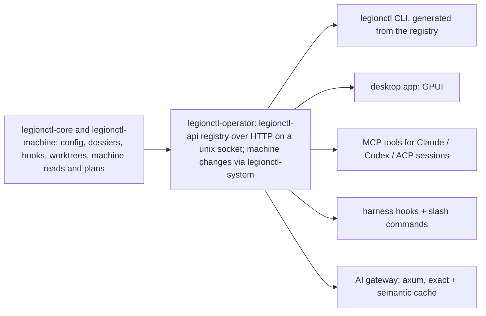

# 12 — Operator and agent harness

One product for operating this laptop and the coding agents that run on it. Humans (desktop app, CLI) and
agents (Claude Code, Codex, ACP sessions) use the same core and the same API, so every capability has exactly one
implementation, one permission model and one audit trail.

## Shape

- **Phase 1a (done):** `legionctl-core`, one client binary and the `legionctl` Claude Code plugin; every surface called
  `legionctl-core` directly. Phase 1b replaced that path.
- **Phase 1b (built 2026-10-13):**
  - `legionctl-api` declares every operation once (name, permission class, input type, output type; the doc comment
    is the help). From that list it generates the HTTP routes, the MCP tools, the CLI (clap builder, from the input
    JSON schemas) and the `Engine` trait that `legionctl-operator` must implement, so a missing handler does not
    compile.
  - Transport: HTTP/JSON on `$XDG_RUNTIME_DIR/legionctl/api.sock`, owned by `legionctl-operator.socket` (systemd
    socket activation; the first request starts the operator). `POST /v1/ops/<name>`, `GET /v1/ops`.
  - The operator reads machine state as the user (status, load, doctor, plans); fan RPM and throttle reasons stay
    `unknown` without root. Machine changes go to `legionctl-system` over D-Bus with polkit (`ApplyPower`,
    `SetPrimaryGpu`, `Cleanup`).
  - Client-only commands: `legionctl mcp` (a surface), and `legionctl run` (it must exec in the
    caller's process; it gets the GPU environment and CPU list from the `internal.gpu.run-env` operation).
  - Paths in inputs (`profile`, `project`, `repo`) are resolved by the client against its own working directory.
  - Every call that is not a read is recorded in the operator event log with the actor (cli, mcp, app).

## Approvals

| Kind | Examples | Gate |
| --- | --- | --- |
| Read | state, load, doctor, configs, worktree list, plan search | none |
| Workspace write | create/remove worktree, write plan files | harness tool permission (Claude/Codex prompt) |
| Machine change | power policy, desktop GPU, kernel modules, packages, sysctl | polkit dialog per action (`pkexec legionctl …`), exact command shown first |
| Account / secret | switch account, store credentials | desktop approval + keyring |

Every request records who asked (human, session id, agent), the exact command or diff, and the outcome. Agents can
always propose; only an approval channel applies.

Built (2026-10-13, DESIGN/03 slice 1): the operator's dispatch audits each call that is not a read as an event whose
kind is the op name: actor, input (fields marked `x-secret` in the schema become `<secret>`, strings over 512 bytes
become their size), outcome code (null on success) and ms. Every error, on the socket, in MCP and from D-Bus, is one
envelope `{"error": {"code", "message", "op"}}` with the codes not_found, invalid_input, conflict, denied,
unavailable, version_mismatch, failed and internal (HTTP 404, 400, 409, 403, 503, 412, 422, 500). `/v1/metrics`
adds calls, errors by code and total ms of each op.

Built (2026-10-13, DESIGN/03 slice 2): every call carries `authorization: Bearer <token>`. The user token is
`$XDG_RUNTIME_DIR/legionctl.token` (0600, made by the first client or the operator); a session's sandbox cannot see
it (its runtime folder is a private tmpfs) and gets its own token as `LEGIONCTL_TOKEN`, which the operator maps to
the session (`tokens` in operator.db, the hash only; a resume issues a new one). A call with a session token has
that session's id in every session field of its input, whatever it sent. Operations named `internal.*` (hooks run,
dossier guard, gates check, tools record, cache get/put, gpu run-env) are for legionctl's own parts and are not in
the CLI or MCP.

Built (2026-10-13, DESIGN/03 slice 3): the classes are `read`, `session` (changes only the caller's own session: its
dossier, its workspace except merge, its hooks), `workspace` (the user's files and settings, other sessions) and
`machine` (polkit in the daemon). An agent's `workspace` call, or a call with a field marked `x-approval` set (such
as `dossier use --steal`), waits for the user: a desktop notification with Allow and Deny, 120 s; Deny, no answer, a
closed notification or no desktop to ask is `denied`. The user's own calls never ask.

Built (2026-10-13, DESIGN/02, todo-65): supervision through systemd. The operator's resident modules (event
recorder, session module, model gateway) set a ready flag once they run. A module that stops before that cannot run
here (no bus, a port in use) and is left out with a log line; one that panics or stops after it ran ends the operator
with an error, and systemd starts it again (`Restart=on-failure`, at most 5 starts in 300 s; the socket keeps
clients waiting). The machine daemon stops the same way when its exec sensor stops.

Built (2026-10-13, DESIGN/03, todo-60 part 1): logs come in pages. `events`, `inspect` (history), `gateway usage`,
`tools calls`, `session activity`, `bench list` and `dossier nudges` take `--cursor` (the `next` of the page before)
and `--limit` (1-1000, default 200) and answer `{items, next}`, oldest first; the filters are SQL (`kind`, a JSON
field of the payload, a text in it; index `events(kind, id)`). Retention: `events.keep_days` (90) removes older
events and gateway usage when the operator starts, before it serves.

Built (2026-10-13, DESIGN/03, todo-60 part 2): one cache contract. The caches live in the disposable
`~/.cache/legionctl/cache.db` (`legionctl_core::cache`): namespaces `tools` (the MCP proxy's results) and `gateway`
(kept answers and their prompt embeddings), each with `cache.<ns>.max_bytes`; a write removes expired entries, then
the least recently used until the namespace fits. The operator builds the keys: the proxy sends the call (server,
tool, arguments, the folder for a tool that reads the working copy), and the key holds the caller's session, so one
sandbox cannot get or plant another session's entries. `legionctl cache stats` and `cache purge [--ns]`.

Removed (2026-10-17, user decision): legionctl's own account logins at rest in the keyring (A1). clauth is the only
store of the user's logins (Accounts, below).

Built (2026-10-14, DESIGN/02, todo-67): jobs. `session run` and `images build` record a job in operator.db (kind,
input, state running/done/failed, attempts, result or error); the caller still waits for the answer. When the
operator starts, a job left `running` (a restart cut it off) is resumed in the background, at most 3 attempts: a build
runs again; a headless run goes on in its own session (same dossier and workspace, and its ACP session with
`session/load` when the agent can load sessions; else a new one) with the task and a note that it was cut off. `legionctl jobs list` and `jobs show
<id>`.

## Worktrees and sandboxes

- **Copy-on-write:** this machine's disks are ext4, which cannot reflink. A worktree is a `git worktree` (shares the
  object store). Heavy build directories (`target/`, `node_modules/`) can be overlay-mounted per worktree with
  kernel overlayfs in the session's user namespace so a new worktree starts from the main checkout's build cache without copying it. On
  btrfs/xfs the same API uses reflink copies.
- **Tracking:** registry of worktrees with repo, branch, plan, session, created, size and dirty state; garbage
  collection proposals for merged or idle worktrees (never automatic deletion of uncommitted work).
- **Sandbox per session:** the agent process runs inside `bwrap` (installed) in its own PID, IPC and network
  namespaces with the worktree read-write, the repo's `.git` config and hooks and the toolchains read-only, the
  agent folders as layers of the session, keys hidden, and no network but the model gateway (14-sessions,
  "Hardened"); the repository's commands for a session run in the same sandbox; `landlock` is not used.

### Can the harness force agents into its sandbox and intercept calls over ACP?

Only by launching them. ACP's client-side `fs/*` and `terminal/*` methods, the hooks a client would use to mediate
reads, writes and commands, are **removed in ACP v2** because few agents used them; agents increasingly execute
directly. The spec also states that declared roots (`additionalDirectories`) are "not, by itself, a sandbox" and that
clients needing boundaries should apply operating-system sandboxing. So:

1. The harness starts each agent process itself, inside the per-session `bwrap` sandbox. That is the enforcement.
2. It answers the agent's `session/request_permission` requests through the approval queue above.
3. It gives each session its capabilities as MCP servers (legion's own tools, plus authorised third-party ones).
4. Durability: a session registry (agent, account, worktree, plan, ACP session id), health checks, and resume via
   `session/load` after a crash or reboot.

## Workspaces

Operating directory, dossier home `~/agentWorkspaces`, dossier and change sets: 18-workspaces.

## Code graph and work ordering

- The graph comes from `ctx graph` (installed, Rust, SQLite-backed): symbols and edges per repo, updated
  incrementally. legion maps each work item's scope (pinned paths and symbols) onto it.
- Ordering: items form a dependency graph (petgraph); the harness proposes an order that minimises rework (an item
  that changes symbols others depend on goes first; items touching the same files are batched) and recomputes it
  when items change. Concurrency is a plan setting (usually one session per project, a few items at once).

## Agents, plugins and settings

- **Settings:** read and validate Claude Code and Codex user/project settings (built: `legionctl agents list`,
  `agents`). Editing: schema-checked (Claude's published settings schema; TOML parse plus known-keys check for
  Codex), shown as a diff, backed up, then written.
  Built (2026-10-13, A1 part 1): `legionctl agents set --agent claude|codex --scope user|project|project-local <key>
  <value> [--dry-run]` sets a dotted key (`permissions.defaultMode`, `mcp_servers.ctx.command`); the value is JSON
  when it parses, else text. It returns only the changed lines (no context: these files hold tokens), copies the
  file to `<file>.legionctl-<time>` first, and writes through a rename. TOML keeps its comments and layout
  (`toml_edit`); JSON is written pretty, so a one-line list in the file becomes lines. An unknown top-level key is
  written with a warning (the published schemas grow each release). `legionctl agents usage [--days N]` counts
  tokens per agent, day and model from Claude Code's transcripts (each message once) and Codex's `token_count`
  events. The rate-limit windows come from the providers (`agents accounts usage`, below).
- **Plugins, MCP servers and skills:** an allowlist of authorised marketplaces and items; install into Claude Code
  (`claude plugin …`) and Codex (`~/.codex/config.toml`) from one place, and show what each agent has loaded.
  Built (2026-10-13, A1 part 3): `plugins.marketplaces` (marketplace name -> `source` and `allow`, plugin names or
  `*`). `legionctl agents plugins install <plugin>@<marketplace> --scope user|project|project-local` refuses anything
  outside it (read from the user's and the system's layers only: a repository cannot widen it; a plugin name is
  a-z, 0-9 and '-', so it cannot pass as a flag), then runs `claude plugin install <plugin> --marketplace <source> --scope <scope> --json` in the
  project, never with `-y`: a command that the marketplace declares stays for a person to accept.
  `legionctl agents plugins list` lists Claude Code's installed plugins (`claude plugin list --json`) and marks those
  outside the allowlist. Codex has no plugin system; MCP servers for sessions go through `mcp.servers` (the proxy)
  and skills through `session.skills`, not into the agents' own files.
- **Accounts:** clauth is the only store of the user's logins (user decision 2026-10-17); legionctl reads clauth's
  files and calls clauth to change them, and keeps no login of its own.
  The accounts: `agents accounts list` and `usage` show every login, each with its source: `current` (the login
  Claude Code and Codex use now, `~/.claude/.credentials.json` and `~/.codex/auth.json`, named by the clauth profile
  that holds the same refresh token, as `clauth which` does; clauth's link first) and `clauth` (clauth's other
  profiles, read only from `~/.clauth`: `profiles.toml` and `codex-profiles.toml` for the roster and the active
  profile, `profiles/<name>/credentials.json` or `auth.json` for the login). Two profiles with the same refresh
  token are two holders of one rotating token (a refresh through one logs the other out): the second one is not
  read, and its row says which profile holds the same login, until the user fixes it in clauth. No token is shown.
  Changes go through clauth: `agents accounts login <name> [--codex]` (`clauth login`, `--codex --browser` for
  Codex; clauth opens the provider's page in the browser), `agents accounts switch <name>` (`clauth switch`),
  `agents accounts capture <name>` (keeps the current logins without a copy, DESIGN-12 wall 1: a login that a
  clauth profile holds is kept already; Claude Code's other login goes to `clauth capture <name>`; a Codex login
  that no clauth profile holds is not kept). legionctl's old account folder (`~/.local/share/legionctl/accounts`)
  is not read: doctor names its profiles with a Log in action for each.
  Sessions: `session start <agent> --account <name>` runs on clauth account `name`: the sandbox binds the profile's
  own login file (the file that `clauth start` links its runtime's `.credentials.json` to) over the agent's login
  path, so a refresh writes the profile's chain and no copy; the other folders are the user's (one transcript
  store, so `session resume <id> --account <name>` goes on with no copy). `clauth start` itself is not used: it
  runs the `claude` command (not the ACP adapter) and keeps a watchdog in its own process. No account: the current
  login. The session keeps its account, so a resume uses it again. `~/.clauth` is hidden in the sandbox.
  Usage (2026-10-17, todo-136; ported in part from clauth 0.17.0, MIT, THIRD-PARTY-NOTICES.md):
  `legionctl agents accounts usage [--account <name>] [--fresh]` reads each login from its provider with its own
  access token: Claude `GET /api/oauth/usage` (`limits[]`: `session` is 5h, `weekly_all` 7d), Codex `GET
  /backend-api/wham/usage` (`rate_limit`: its windows by `limit_window_seconds`). One shape per provider, the one
  that clauth 0.17.0 and the live answer use (checked 2026-10-17); another shape is that account's error with the
  field. The token is only read: never refreshed (the agents rotate their refresh tokens), written, printed or
  logged; an expired Claude token is "login needed" and is not sent. A failed read is that account's error with its
  cause, never zero use. Each answer or error is kept in cache.db (namespace `accounts`) for
  `agents.accounts.usage_ttl_s` with its fetch time; the seed view `accounts` shows them. `agents usage` counts the
  tokens of the transcripts in `~/.claude` and `~/.codex`. Switch at the limit: with
  `agents.accounts.fallback.<agent>` set (none: no switch), an operator member whose account has a window at
  `agents.accounts.switch_at` percent or more starts or resumes its next wake (`session resume --account`) on the
  first listed account under it, with a `thread.account` row, a note to main0 and an `agents.accounts.switch` event;
  when no listed account is under it, the wake fails with the reason (the restart limit applies). The check runs at
  the start of a wake, so a turn is never cut. A failed usage read of the member's account fails the wake with its
  reason (user decision 2026-10-17). `thread account <thread> [--account <name>] [--member <m>]` (the app's
  member chip and chat bar) picks an operator member's account from its next wake, or the chat bar's; no
  `--account` is the current login; a teammate or a Codex subagent is refused. Only the defaults, /etc/legionctl and
  the user layer set `agents.accounts`. The `views.ask` steps keep the account the composer ran on, and
  `views.cost` counts per step and account.

## AI gateway

Models, accounts, quotas, budgets, cache and replay, over HTTP and ACP: 19-gateway.

## Crates

| Need | Crate |
| --- | --- |
| API / gateway | axum, tower-http |
| Desktop app | gpui |
| MCP | rmcp |
| ACP | agent-client-protocol |
| Git | gix (gitoxide); git CLI where gix lacks a feature |
| Code graph | ctx graph (external) or tree-sitter + petgraph |
| Search | tantivy; fastembed for local embeddings |
| Storage | redb (cache, registries), serde/toml |
| System | zbus (D-Bus: logind, PPD, polkit), sysinfo, landlock |
| Agents in the harness | adk-rust, optional (below) |

**adk-rust** (v2.3, active) is a framework for building agents: model adapters, tools, memory. The harness mainly
orchestrates external agents (Claude Code, Codex) over ACP, so adk-rust is not core. It fits if the harness grows
its own helper agents, such as the work-ordering planner or the intent-log summariser.

## Phases

| Phase | Delivers |
| --- | --- |
| 1a (done) | legionctl-core, client CLI/stdio MCP, Claude Code plugin, Codex MCP snippet |
| 1b (done 2026-10-13) | legionctl-operator with the operation registry on a unix socket; CLI and MCP as clients; audit log |
| 2 | Sandboxed ACP sessions (bwrap), session registry and resume, overlay build caches; detail in 14-sessions |
| 3 (milestone 1 done 2026-10-13: dossier, binding, gate) | Workspaces: the dossier home (`~/agentWorkspaces` since design 23 P9), dossier, change sets, gate (18-workspaces) |
| 4 | Code graph mapping and dependency ordering of work items |
| 5 | Settings editing, plugin/MCP/skill management, accounts and usage |
| 6 | AI gateway with exact and semantic cache |
| 7 | GPUI desktop app over the same API |
