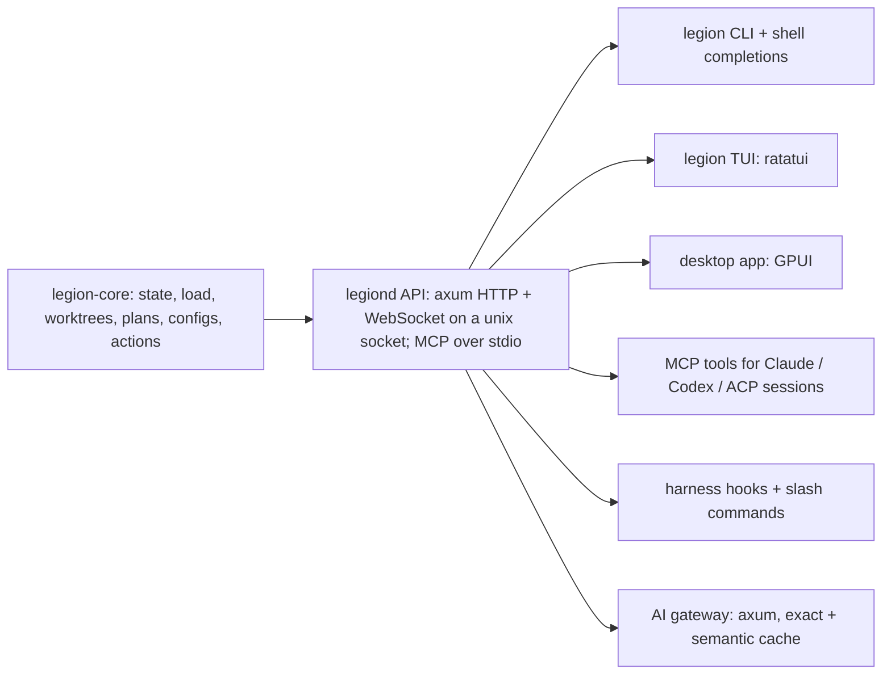

# 12 — Operator and agent harness

One product for operating this laptop and the coding agents that run on it. Humans (CLI, TUI, desktop app) and
agents (Claude Code, Codex, ACP sessions) use the same core and the same API, so every capability has exactly one
implementation, one permission model and one audit trail.

## Shape



- **Today (Phase 1a, built):** `legion-core` plus one `legion` binary that is CLI, TUI and stdio MCP server, and a
  Claude Code plugin (MCP server, load hooks, `/legion:status`, `/legion:worktree`, `/legion:act`). Every surface calls
  `legion-core` directly.
- **Next (Phase 1b):** `legiond` owns state and long-running work (sessions, gateway, indexing) and exposes an axum
  API on `$XDG_RUNTIME_DIR/legion/api.sock`; `legion` becomes a client of it. `legion mcp` keeps working: it proxies
  tools to the daemon when it runs and falls back to direct calls when it does not.

## Approvals

| Kind | Examples | Gate |
| --- | --- | --- |
| Read | state, load, doctor, configs, worktree list, plan search | none |
| Workspace write | create/remove worktree, write plan files | harness tool permission (Claude/Codex prompt) |
| Machine change | power policy, desktop GPU, kernel modules, packages, sysctl | polkit dialog per action (`pkexec legionctl …`), exact command shown first |
| Account / secret | switch account, store credentials | desktop approval + keyring |

Every request records who asked (human, session id, agent), the exact command or diff, and the outcome. Agents can
always propose; only an approval channel applies.

## Worktrees and sandboxes

- **Copy-on-write:** this machine's disks are ext4, which cannot reflink. A worktree is a `git worktree` (shares the
  object store). Heavy build directories (`target/`, `node_modules/`) can be overlay-mounted per worktree with
  `fuse-overlayfs` (installed) so a new worktree starts from the main checkout's build cache without copying it. On
  btrfs/xfs the same API uses reflink copies.
- **Tracking:** registry of worktrees with repo, branch, plan, session, created, size and dirty state; garbage
  collection proposals for merged or idle worktrees (never automatic deletion of uncommitted work).
- **Sandbox per session:** the agent process runs inside `bwrap` (installed) with the worktree read-write, the repo's
  `.git` and toolchains read-only, `$HOME` replaced by a session home, and network on/off per policy; `landlock`
  adds a second, in-process boundary where supported.

### Can the harness force agents into its sandbox and intercept calls over ACP?

Only by launching them. ACP's client-side `fs/*` and `terminal/*` methods, the hooks a client would use to mediate
reads, writes and commands, are **removed in ACP v2** because few agents used them; agents increasingly execute
directly. The spec also states that declared roots (`additionalDirectories`) are "not, by itself, a sandbox" and that
clients needing boundaries should apply operating-system sandboxing. So:

1. The harness starts each agent process itself, inside the per-session `bwrap` sandbox. That is the enforcement.
2. It answers the agent's `session/request_permission` requests through the approval queue above.
3. It gives each session its capabilities as MCP servers (legion's own tools, plus authorised third-party ones).
4. Durability: a session registry (agent, account, worktree, plan, ACP session id), health checks, and resume via
   `session/load` after a crash or reboot.

## Plan workspaces (agent task memory)

A plan is a folder with a semi-flexible schema; sessions declare which plan they work on and can switch.

```
plans/<plan-id>/
  plan.toml            title, status, repos, active items, concurrency limit, owning session
  code/                objectives.md  goals.md  non-goals.md  accepted-debts.md  where.md (new / changed / where / what)
  intent/log.jsonl     insights and decisions; read and updated before each work item starts
  evidence/            proofs/  prototypes/  research/  crawls/
  verifications/       e2e/  ui/  evals/
  items/<id>.toml      scope (paths, symbols), dependencies, status, worktree, evidence links
```

- Search: full-text (tantivy) over intent, evidence and items, with optional local semantic search (fastembed).
- The harness hook injects the active plan and current item at session start, and nudges an intent-log update
  before an item is marked done.

## Code graph and work ordering

- The graph comes from `ctx graph` (installed, Rust, SQLite-backed): symbols and edges per repo, updated
  incrementally. legion maps each work item's scope (pinned paths and symbols) onto it.
- Ordering: items form a dependency graph (petgraph); the harness proposes an order that minimises rework (an item
  that changes symbols others depend on goes first; items touching the same files are batched) and recomputes it
  when items change. Concurrency is a plan setting (usually one session per project, a few items at once).

## Agents, plugins and settings

- **Settings:** read and validate Claude Code and Codex user/project settings (built: `legion agents`,
  `agent_configs`). Editing: schema-checked (Claude's published settings schema; TOML parse plus known-keys check for
  Codex), shown as a diff, backed up, then written.
- **Plugins, MCP servers and skills:** an allowlist of authorised marketplaces and items; install into Claude Code
  (`claude plugin …`) and Codex (`~/.codex/config.toml`) from one place, and show what each agent has loaded.
- **Accounts:** one profile per account (`CLAUDE_CONFIG_DIR` / `CODEX_HOME`), credentials in the keyring; an ACP
  session can be restarted on another account with the same worktree, plan and sandbox. Usage per account from local
  transcripts (token counts) and the gateway's rate-limit headers, shown against quotas.

## AI gateway

- axum service on localhost exposing OpenAI- and Anthropic-compatible endpoints, forwarding to the real providers.
- Exact cache (hash of the normalised request) and semantic cache (local embeddings plus nearest-neighbour search,
  similarity threshold per model), stored in redb; per-model TTL.
- UI: a table of cache entries with filters (model, age, size, hit count, prompt text) and bulk delete.
- Local only by default; prompts can contain secrets, so the cache is per user and excluded from backups unless chosen.

## Crates

| Need | Crate |
| --- | --- |
| API / gateway | axum, tower-http |
| Desktop app | gpui |
| TUI | ratatui |
| MCP | rmcp |
| ACP | agent-client-protocol |
| Git | gix (gitoxide); git CLI where gix lacks a feature |
| Code graph | ctx graph (external) or tree-sitter + petgraph |
| Search | tantivy; fastembed for local embeddings |
| Storage | redb (cache, registries), serde/toml |
| System | zbus (D-Bus: logind, PPD, polkit), sysinfo, landlock |
| Agents in the harness | adk-rust, optional (below) |

**adk-rust** (v2.3, active) is a framework for building agents: model adapters, tools, memory. The harness mainly
orchestrates external agents (Claude Code, Codex) over ACP, so adk-rust is not core. It fits if the harness grows
its own helper agents, such as the work-ordering planner or the intent-log summariser.

## Phases

| Phase | Delivers |
| --- | --- |
| 1a (done) | legion-core, legion CLI/TUI/stdio MCP, Claude Code plugin, Codex MCP snippet |
| 1b | legiond with axum API on a unix socket; legion as client; audit log |
| 2 | Sandboxed ACP sessions (bwrap), session registry and resume, overlay build caches |
| 3 | Plan workspaces, intent log, search, session-declared active plan |
| 4 | Code graph mapping and dependency ordering of work items |
| 5 | Settings editing, plugin/MCP/skill management, accounts and usage |
| 6 | AI gateway with exact and semantic cache |
| 7 | GPUI desktop app over the same API |
