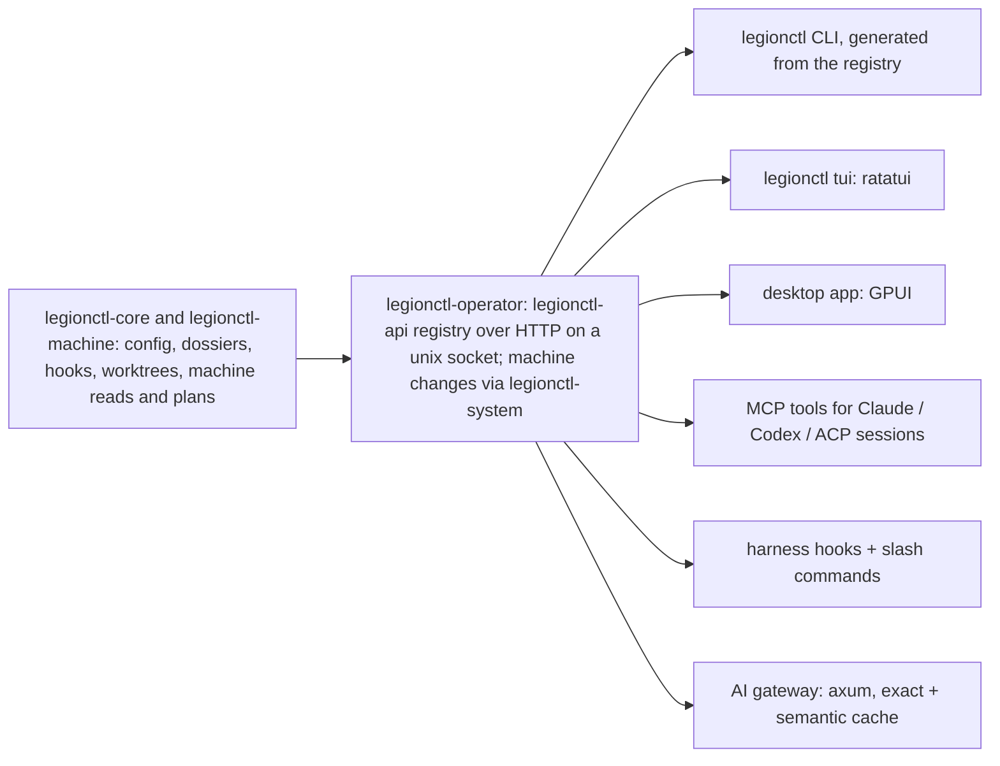

# 12 — Operator and agent harness

One product for operating this laptop and the coding agents that run on it. Humans (CLI, TUI, desktop app) and
agents (Claude Code, Codex, ACP sessions) use the same core and the same API, so every capability has exactly one
implementation, one permission model and one audit trail.

## Shape

- **Phase 1a (done):** `legionctl-core`, one client binary and the `legionctl` Claude Code plugin; every surface called
  `legionctl-core` directly. Phase 1b replaced that path.
- **Phase 1b (built 2026-10-13):**
  - `legionctl-api` declares every operation once (name, permission class, input type, output type; the doc comment
    is the help). From that list it generates the HTTP routes, the MCP tools, the CLI (clap builder, from the input
    JSON schemas) and the `Engine` trait that `legionctl-operator` must implement, so a missing handler does not
    compile.
  - Transport: HTTP/JSON on `$XDG_RUNTIME_DIR/legionctl/api.sock`, owned by `legionctl-operator.socket` (systemd
    socket activation; the first request starts the operator). `POST /v1/ops/<name>`, `GET /v1/ops`.
  - The operator reads machine state as the user (status, load, doctor, plans); fan RPM and throttle reasons stay
    `unknown` without root. Machine changes go to `legionctl-system` over D-Bus with polkit (`Apply`,
    `SetDesktopGpu`, `Cleanup`).
  - Client-only commands: `legionctl mcp` and `legionctl tui` (surfaces), and `legionctl run` (it must exec in the
    caller's process; it gets the GPU environment and CPU list from the `gpu.run-env` operation).
  - Paths in inputs (`profile`, `project`, `repo`) are resolved by the client against its own working directory.
  - Every call that is not a read is recorded in the operator event log with the actor (cli, mcp, tui).

## Approvals

| Kind | Examples | Gate |
| --- | --- | --- |
| Read | state, load, doctor, configs, worktree list, plan search | none |
| Workspace write | create/remove worktree, write plan files | harness tool permission (Claude/Codex prompt) |
| Machine change | power policy, desktop GPU, kernel modules, packages, sysctl | polkit dialog per action (`pkexec legionctl …`), exact command shown first |
| Account / secret | switch account, store credentials | desktop approval + keyring |

Every request records who asked (human, session id, agent), the exact command or diff, and the outcome. Agents can
always propose; only an approval channel applies.

## Worktrees and sandboxes

- **Copy-on-write:** this machine's disks are ext4, which cannot reflink. A worktree is a `git worktree` (shares the
  object store). Heavy build directories (`target/`, `node_modules/`) can be overlay-mounted per worktree with
  kernel overlayfs in the session's user namespace so a new worktree starts from the main checkout's build cache without copying it. On
  btrfs/xfs the same API uses reflink copies.
- **Tracking:** registry of worktrees with repo, branch, plan, session, created, size and dirty state; garbage
  collection proposals for merged or idle worktrees (never automatic deletion of uncommitted work).
- **Sandbox per session:** the agent process runs inside `bwrap` (installed) with the worktree read-write, the repo's
  `.git` and toolchains read-only, `$HOME` replaced by a session home, and network on/off per policy; `landlock`
  adds a second, in-process boundary where supported.

### Can the harness force agents into its sandbox and intercept calls over ACP?

Only by launching them. ACP's client-side `fs/*` and `terminal/*` methods, the hooks a client would use to mediate
reads, writes and commands, are **removed in ACP v2** because few agents used them; agents increasingly execute
directly. The spec also states that declared roots (`additionalDirectories`) are "not, by itself, a sandbox" and that
clients needing boundaries should apply operating-system sandboxing. So:

1. The harness starts each agent process itself, inside the per-session `bwrap` sandbox. That is the enforcement.
2. It answers the agent's `session/request_permission` requests through the approval queue above.
3. It gives each session its capabilities as MCP servers (legion's own tools, plus authorised third-party ones).
4. Durability: a session registry (agent, account, worktree, plan, ACP session id), health checks, and resume via
   `session/load` after a crash or reboot.

## Workspaces

Operating directory, named workspace in `~/.agentworkspace`, dossier and change sets: 18-workspaces.

## Code graph and work ordering

- The graph comes from `ctx graph` (installed, Rust, SQLite-backed): symbols and edges per repo, updated
  incrementally. legion maps each work item's scope (pinned paths and symbols) onto it.
- Ordering: items form a dependency graph (petgraph); the harness proposes an order that minimises rework (an item
  that changes symbols others depend on goes first; items touching the same files are batched) and recomputes it
  when items change. Concurrency is a plan setting (usually one session per project, a few items at once).

## Agents, plugins and settings

- **Settings:** read and validate Claude Code and Codex user/project settings (built: `legionctl agents list`,
  `agents`). Editing: schema-checked (Claude's published settings schema; TOML parse plus known-keys check for
  Codex), shown as a diff, backed up, then written.
  Built (2026-10-13, A1 part 1): `legionctl agents set --agent claude|codex --scope user|project|project-local <key>
  <value> [--dry-run]` sets a dotted key (`permissions.defaultMode`, `mcp_servers.ctx.command`); the value is JSON
  when it parses, else text. It returns only the changed lines (no context: these files hold tokens), copies the
  file to `<file>.legionctl-<time>` first, and writes through a rename. TOML keeps its comments and layout
  (`toml_edit`); JSON is written pretty, so a one-line list in the file becomes lines. An unknown top-level key is
  written with a warning (the published schemas grow each release). `legionctl agents usage [--days N]` counts
  tokens per agent, day and model from Claude Code's transcripts (each message once) and Codex's `token_count`
  events, with Codex's rate-limit use.
- **Plugins, MCP servers and skills:** an allowlist of authorised marketplaces and items; install into Claude Code
  (`claude plugin …`) and Codex (`~/.codex/config.toml`) from one place, and show what each agent has loaded.
  Built (2026-10-13, A1 part 3): `plugins.marketplaces` (marketplace name -> `source` and `allow`, plugin names or
  `*`). `legionctl agents plugin-install <plugin>@<marketplace> --scope user|project|project-local` refuses anything
  outside it (read from the user's and the system's layers only: a repository cannot widen it; a plugin name is
  a-z, 0-9 and '-', so it cannot pass as a flag), then runs `claude plugin install <plugin> --marketplace <source> --scope <scope> --json` in the
  project, never with `-y`: a command that the marketplace declares stays for a person to accept.
  `legionctl agents plugins` lists Claude Code's installed plugins (`claude plugin list --json`) and marks those
  outside the allowlist. Codex has no plugin system; MCP servers for sessions go through `mcp.servers` (the proxy)
  and skills through `session.skills`, not into the agents' own files.
- **Accounts:** one profile per account (`CLAUDE_CONFIG_DIR` / `CODEX_HOME`), credentials in the keyring; an ACP
  session can be restarted on another account with the same worktree, plan and sandbox. Usage per account from local
  transcripts (token counts) and the gateway's rate-limit headers, shown against quotas.
  Built (2026-10-13, A1 part 2): `legionctl agents account-add <name>` makes
  `~/.local/share/legionctl/accounts/<name>/{claude,codex}` and prints the login commands; `agents accounts` lists the
  profiles and which agents have a login in them. `session start <agent> --account <name>` binds the profile writable
  into the sandbox and sets `CLAUDE_CONFIG_DIR` and `CODEX_HOME` there; the session keeps its account, so a resume
  uses it again. `agents usage --account <name>` reads the profile's transcripts. An account name has the dossier name
  rules, so it cannot leave the profiles folder. Logins stay in the agents' own files in the profile (not the
  keyring: the agents read only their files). `session resume <id> --account <name>` continues a session on another
  profile (another login, other rate limits): it copies Claude Code's transcript (`projects/<folder>/<id>.jsonl` and
  its `<id>/` folder; regular files and folders only, as the agent can plant symlinks there) into that profile,
  after the dossier is bound, records the new account, and runs the resume command there. The old profile
  keeps its copy. Codex has no resume by id, so its sessions start anew.

## AI gateway

Models, accounts, quotas, budgets, cache and replay, over HTTP and ACP: 19-gateway.

## Crates

| Need | Crate |
| --- | --- |
| API / gateway | axum, tower-http |
| Desktop app | gpui |
| TUI | ratatui |
| MCP | rmcp |
| ACP | agent-client-protocol |
| Git | gix (gitoxide); git CLI where gix lacks a feature |
| Code graph | ctx graph (external) or tree-sitter + petgraph |
| Search | tantivy; fastembed for local embeddings |
| Storage | redb (cache, registries), serde/toml |
| System | zbus (D-Bus: logind, PPD, polkit), sysinfo, landlock |
| Agents in the harness | adk-rust, optional (below) |

**adk-rust** (v2.3, active) is a framework for building agents: model adapters, tools, memory. The harness mainly
orchestrates external agents (Claude Code, Codex) over ACP, so adk-rust is not core. It fits if the harness grows
its own helper agents, such as the work-ordering planner or the intent-log summariser.

## Phases

| Phase | Delivers |
| --- | --- |
| 1a (done) | legionctl-core, client CLI/TUI/stdio MCP, Claude Code plugin, Codex MCP snippet |
| 1b (done 2026-10-13) | legionctl-operator with the operation registry on a unix socket; CLI, TUI and MCP as clients; audit log |
| 2 | Sandboxed ACP sessions (bwrap), session registry and resume, overlay build caches; detail in 14-sessions |
| 3 (milestone 1 done 2026-10-13: dossier, binding, gate) | Workspaces: `~/.agentworkspace`, dossier, change sets, gate (18-workspaces) |
| 4 | Code graph mapping and dependency ordering of work items |
| 5 | Settings editing, plugin/MCP/skill management, accounts and usage |
| 6 | AI gateway with exact and semantic cache |
| 7 | GPUI desktop app over the same API |
