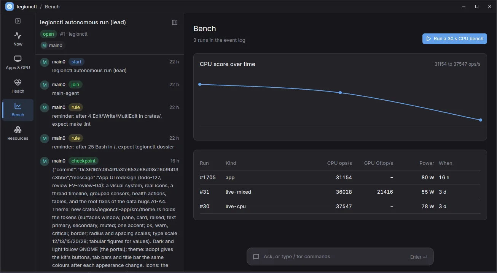

# Use legionctl

This guide tells you how to install legionctl, use the app, and give work to agents safely. Each
command here is on main. A feature that is not on main has the label "planned (v1)".

| Section | You want to |
| --- | --- |
| [Install](#install) | install the package, the services and the agent setup |
| [The app](#the-app) | see the machine and talk to an agent |
| [Commands by task](#commands-by-task) | find the command for a task |
| [Dossiers and workspaces](#dossiers-and-workspaces) | keep an agent's work and memory |
| [Threads and observers](#threads-and-observers) | let agents check each other |
| [rlcd](#rlcd) | fast typed decisions for observers |
| [Sessions and sandboxes](#sessions-and-sandboxes) | run an agent isolated or headless |
| [Greeter and boot entry](#greeter-and-boot-entry) | the login screen and the systemd-boot entry |
| [Safety](#safety) | know what needs you |

## Install

1. Build and install the Arch package. The first time, sudo asks for your password.

   ```bash
   make install-package
   ```

   The package turns on these services and prints one line for each. An upgrade restarts the ones that run with the
   new build; a service that you turned off stays off.

   | Service | What it does | Turn it off | Turn it on again |
   | --- | --- | --- | --- |
   | `legionctl-system` | the root daemon: power policy, Fn keys, the machine's D-Bus API | `sudo systemctl disable --now legionctl-system.service` | `sudo systemctl enable --now legionctl-system.service` |
   | `scx_loader` (with scx-tools) | loads the sched_ext CPU scheduler | `sudo systemctl disable --now scx_loader.service` | `sudo systemctl enable --now scx_loader.service` |
   | `legionctl-operator` | your API: the commands and the app of each user talk to it | `sudo systemctl --global disable legionctl-operator.socket legionctl-operator.service` | `systemctl --user enable --now legionctl-operator.socket` |

   When a service of legionctl is off, the command that needs it says so with its line. In the app, the
   operator card has **Turn on**, and Health has **Turn on** for the root daemon (polkit asks for your password).
   `legionctl setup check` shows the state of each.

2. Set up the rest as your user. This enables the OSD (it shows at the next login), installs the legionctl plugin
   into Claude Code and into Codex from the package folder (the plugin and the binary are then of one build: the MCP
   server, the hooks and the skills), writes the agents for Codex, and installs the ACP adapters (`claude-code-acp`, `codex-acp`) with bun
   into ~/.bun. legionctl runs the adapters with bun, so they need no Node.js; a chat installs a missing adapter by
   itself. Codex runs the legionctl hooks after you trust them: start Codex once and choose to trust them when it
   asks.
   It also installs clauth 0.17, the account engine (`cargo install clauth --version ~0.17 --locked`; cargo comes
   with the `rust` package), starts clauth's daemon as the user unit `legionctl-clauth.service` (it reads each
   account's use and switches at the limit) and adds clauth's MCP server to Claude Code. A clauth of another
   version stays as it is; doctor says so. It changes only your user files, with backups.

   ```bash
   legionctl setup apply
   legionctl setup check     # each line "current", then "all set up"
   ```

3. Run `legionctl doctor`. Each finding names the command that fixes it.

Optional packages enable more parts (`pacman -Qi legionctl` lists them): `greetd` and `cage` for the greeter,
`systemd-ukify` and `sbsigntools` for the boot entry, `docker` or `qemu-base` for sandboxed sessions, `stress-ng`
for bench and tune.

## The app

`legionctl-app [<view> [name=value...]]` opens the desktop app. It needs the operator.

| Part | What |
| --- | --- |
| Rail | the spaces Machine, Work and Agents, and Activity |
| Navigator | the views of the space (in Work: New chat and your chats, newest first); drag its edge to change its width |
| Tabs | each tab is one view (one that comes with legionctl, one of yours, or one that an agent made), or a chat |
| Chat bar | `/` lists the commands; other text is a message to the agent: in a chat, to the chat's agent; in a view, to the agent that makes views, which changes the tab's view (a new version; Undo goes back) or answers in words. Help > What agents can change |
| Feedback | the title bar's Feedback or `/feedback <note>`: your note, the tab's state and a screenshot of the window that you pick go to the dossier as `feedbacks/<NNNN>-<slug>/` (it cannot change after) |

A chat keeps its conversation in a dossier. Choose one with `/dossier use <name>`, or make one with `/dossier create
<name>` (the title bar shows it; a click opens the Dossiers view).

Help in the title bar: About (the builds of the operator and the daemon, and whether they match; the machine profile;
the licenses), Feedback, and Keys. Ctrl+K searches the views, commands and operations (the chat bar with `/`).

Keys: Up and Down in the chat bar show the lines that you sent before (also after a restart). PageUp, PageDown, Home
and End scroll the tab. Tab with nothing to complete goes to the tab, where Up and Down scroll; Tab goes back. Select
text with the mouse and copy it with Ctrl+C; the copy button of a table row or an error copies it whole.

Pick the agent of the chat bar with `/agent claude` or `/agent codex` (the names of config `session.acp`). The pick
is a row of the thread's log, so every app window on the thread uses the same agent. With no pick, config `app.agent` applies
(default `claude`).

Each screen is a view (`legionctl views list`). A message in a view's tab goes to the composer with that view and
never opens another view: its answer is words, or the view's next version. `legionctl ask` with no `--view` finds a
view in three steps; each step is recorded with its tokens and time (`legionctl views cost`, the view Cost of the
views that agents make):

1. Stored: the view whose intent it is word for word. No model runs.
2. rlcd (config `views.rlcd`, off by default; for development, `rlcd.backend` `openrouter-free` is the free
   model): a pick among the stored intents that share a word with it. A failed rlcd call fails the ask;
   the composer does not run in its place.
3. Composer: the chat bar's agent (`/agent claude`; Haiku on Claude Code) makes a view. It gets the view tools only
   (no data, file or shell tools) and the parts of the library that fit the intent (`legionctl views parts`). A
   stack places a part by name and version, so a new version of a part does not change the views that pin the old
   one. The view is checked before it is saved; the next ask of the same intent is step 1.

On Codex (`/agent codex`, Luna) the composer runs in its own Codex home: no shell, patch, image or web tool, and
none of your Codex config, plugins, hooks or MCP servers.



## Commands by task

`legionctl --help` lists every command group. The table of groups, with the permission class and the skill of each,
is [reference-command-groups.md](../../integrations/agent-plugin/skills/tool-lifecycle/refs/reference-command-groups.md).

| Task | Commands |
| --- | --- |
| Look at the machine | `status`, `sensors`, `monitor`, `load`, `doctor`, `events`, `trace` |
| Power policy | `plan`, `knobs list`, `knobs show <knob>`, `rules list`, `rules enable <layer>`, `power apply`, `undo <event>` |
| Fans and battery | `fan status`, `fan max`, `battery status`, `battery mode` |
| GPU and display | `gpu status`, `gpu primary`, `gpu give`, `display status`, `display fix <id>`, `run --gpu nvidia -- <cmd>` |
| Kernels and boot | `kernel list`, `kernel try`, `kernel cmdline set`, `kernel bench`, `kernel build`, `boot status` |
| Windows | `windows status`, `windows reboot`, `windows vm start`, `windows disk attach` |
| Measure and record | `bench run`, `bench compare`, `tune`, `record <dir>`, `replay <dir>` |
| Resources | `resources list`, `resources act` (VMs, GPU, mounts, configsets, sessions, workspaces) |

## Dossiers and workspaces

A dossier is the memory of one piece of work, in `~/agentWorkspaces/<name>/`: `plan.md`, numbered `MEMORY`,
`DESIGN`, `EVIDENCE`, `SPIKE` and `JOURNAL` files. Each agent session binds one dossier; the hooks block prompts until
it has one.

```bash
legionctl dossier list
legionctl dossier read legionctl/plan.md
legionctl dossier check                 # missing plan sections, links to nothing
```

A workspace is a git worktree for a dossier (branch `legionctl/<dossier>`) or for a topic
(`legionctl/<dossier>--<topic>`), so parallel agents do not change the main checkout.

```bash
legionctl workspace open --topic docs-refresh
legionctl workspace checkpoint --topic docs-refresh "message"   # runs the gate: checks and the test review
legionctl workspace merge --topic docs-refresh                    # rebase, gate, fast-forward
```

The code graph shows what a branch changed (`legionctl code graph changes`); the planned graph in `planning/`
compares planned and built work (`legionctl code plan status`). The rules: skills `dossier-practice` and
`workspace-practice`.

## Threads and observers

A thread is one task. `main0` owns it; observers watch its events, review its tests and remind it of skipped steps.

```bash
legionctl thread start "Fix the fan page" --team vanilla   # main0, thread-observer, ui-composer
legionctl thread show 1
legionctl thread peers                                    # who else works on this dossier, and their state
```

An observer sends a `note`, `reminder` or `result`; a `hard-block` holds the main agent's tool until it acks
(`thread ack <id>`). The outbox is in the operator's database, so messages survive restarts and compactions. The
full list: [reference-threads.md](../../integrations/agent-plugin/skills/sessions-and-agents/refs/reference-threads.md).

## rlcd

rlcd is a decision tier for agents: a hosted "System One" model answers typed questions (`choice`, `yesno`, `score`)
on a state. It gives no text, only the typed answers. The vendors give 70-500 ms and a low price per call.

```bash
legionctl rlcd ask --state "tests failed after the last edit" 'next:choice:ignore,note,escalate'
legionctl rlcd decisions     # each decision with its later outcome
```

The backends are in config `rlcd.backends`, with two wire shapes: `system-one` (OpenRouter) and `openai`. The key
is in the keyring. The state leaves the machine with its secrets removed. A team member with
`route: ["rlcd", "acp"]` wakes its agent only when rlcd escalates. A failed rlcd call fails; the next step does not
run in its place.

Planned (v1): the `api` route step and rlcd on hot paths such as gateway model choice and the chat bar.

## Sessions and sandboxes

A session is one agent (Claude Code or Codex) that legionctl starts in a sandbox, in the dossier's workspace.

```bash
legionctl session start claude                       # interactive, in this terminal
legionctl session run claude "fix the failing test"  # headless, through ACP; returns the answer
legionctl session list
```

| Option | What |
| --- | --- |
| `--in host` | bwrap: your home read-only, the workspace writable |
| `--in container` | docker; the first session makes the repository's image |
| `--in vm` | QEMU; the first session makes the repository's disk |
| `--gpu` | the NVIDIA GPU for this run only |
| `--account <name>` | another clauth account, with its own login and limits |

In each sandbox `git` is the git gate: local commands run; push, fetch, `reset --hard`, rebase and other history or
remote commands are refused. MCP servers come through `legionctl mcp-proxy`, which logs each call. When
`gateway.port` is set, the model gateway counts tokens and cost and enforces budgets, and a session has no
network but the gateway: its other HTTPS calls go through the gateway to the connections the session got
(`legionctl runnables show <session>`), each one an event. Details: skill `sessions-and-agents`.

Planned (v1): programs that do not use a proxy (the transparent path), and snapshots with write-back and undo.

## Greeter and boot entry

The greeter is legionctl's login screen under greetd, in place of GDM. GDM stays installed and disabled.

```bash
legionctl greeter status
legionctl greeter install --dry-run
legionctl greeter install        # at the next start; legionctl greeter remove brings GDM back
```

It lists the desktops of `/usr/share/wayland-sessions` and comes back after you log out. Before login, it can start
or stop the Windows VM, attach the Windows disk and set the desktop GPU, each through the root daemon. It
remembers your last desktop.

The boot entry is systemd-boot with a signed kernel image per kernel, started through a copy of shim, beside the
entry you have now. `kernel default` and `kernel try` need it. After the install, restart once: that start uses
legionctl's entry one time. If the desktop comes up, the entry becomes the default by itself and a desktop notice
says so. If that start fails, the start after uses the entry that started the computer before, and `legionctl doctor` tells you what to do.

```bash
legionctl boot status
legionctl boot install --dry-run
legionctl boot install           # then restart once
```

Caution: install `systemd-ukify` and `sbsigntools` before `boot install`. A missing tool stops the install at its
step.

## Settings

Settings are JSONC files in layers. Each layer overrides the layers before it:

1. the built-in defaults;
2. this computer: `/etc/legionctl`;
3. you: `~/.config/legionctl`;
4. the repository: its `.legionctl` folder in git;
5. you, for one repository: `~/.config/legionctl/repos/<repo>/`, outside git.

```bash
legionctl config layers                                # each layer, its folder and files, and problems
legionctl config settings --key workspace.nudge        # the value and the layer that set it
legionctl config set checks.required '["lint"]' --scope user-repo
```

Your folder for one repository holds the same files as `.legionctl`: config files, `checks.jsonc` and
`capabilities/`. It takes only the settings that a project can set. A setting for you everywhere (for example
`gateway.port`) is ignored there, and `config layers` shows one line about it.

`<repo>` is the name that git gives the repository: the folder name of the parent of
`git rev-parse --git-common-dir`. Usually this is the folder name of the main checkout, so the main checkout and each
of its worktrees use the same folder. Two special cases:

- A checkout made with `git init --separate-git-dir <folder>/<name>.git` gets the name of `<folder>`.
- Each submodule gets the name `modules`.

When two repositories that legionctl knows have the same name, they share one folder. `config layers` and `doctor`
then show one line that names both paths. To keep them apart, rename the folder of one main checkout.

A session can write only its workspace, its dossier and its own layers; its `/tmp` is private and `/var/tmp` is
read-only. A repository whose tests keep their files in `/var/tmp` (legionctl's own tests do) asks for the capability
set `var-tmp-write`, which makes the computer's `/var/tmp` writable. That folder is shared with your other programs, so
legionctl does not allow the set by default. Allow it for one repository, then start the session with the set:

```jsonc
// ~/.config/legionctl/repos/<repo>/config.jsonc (or the repository's .legionctl, which you allow once)
{ "actions": { "allow+": [{ "pattern": "toolset:var-tmp-write", "reason": "the tests keep their files in /var/tmp" }] } }
```

```bash
legionctl session start claude --capability var-tmp-write
```

## Safety

| Class | Who approves | Examples |
| --- | --- | --- |
| `read` | nobody; it changes nothing | `status`, `doctor`, `plan`, `dossier read` |
| `session` | nobody; only the caller's own session | `dossier write`, `workspace checkpoint` |
| `workspace` | you, for a sandboxed agent: a desktop notification, 120 s | `session start`, `workspace merge`, `rules edit` |
| `machine` | you, in a polkit dialog; an agent cannot | `power apply`, `kernel try`, `boot install`, `fan max` |

More rules:

- A repository's `.legionctl` files (config, checks, teams, views) and its compose file are used only after you
  allow them once. legionctl asks on the desktop the first time, and again when a file changes. A repository never
  chooses the account that pays, and never hides your teams or views.
- An agent outside a sandbox cannot answer a question. Its change of your hooks or reminders asks you.
- A button of a built-in view or of your own view runs at once when it reads or changes only your own choices. A
  button of a project's view or of a view that the composer made asks you first for every change.

Your rules for agents:

- Do not guess ACPI or WMI write calls on the real firmware.
- Do not run `windows reboot`, tune sweeps or polkit writes live.
- Do not pause your WinBoat VM.
- Never return secrets.
- Make only safe live writes: read-only checks, recorded runs, containers without a GPU, short stress runs.

What stays with you: each polkit dialog, merges of `.legionctl/` changes, the first `boot install`, fan curve writes
(the WMI calls are not verified yet), and the first live use of a GPU in a VM.
